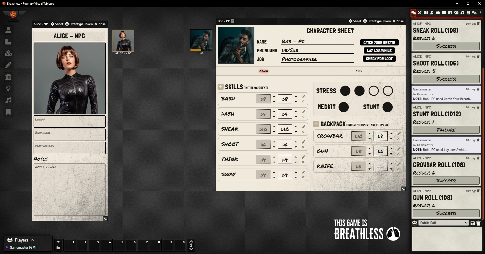
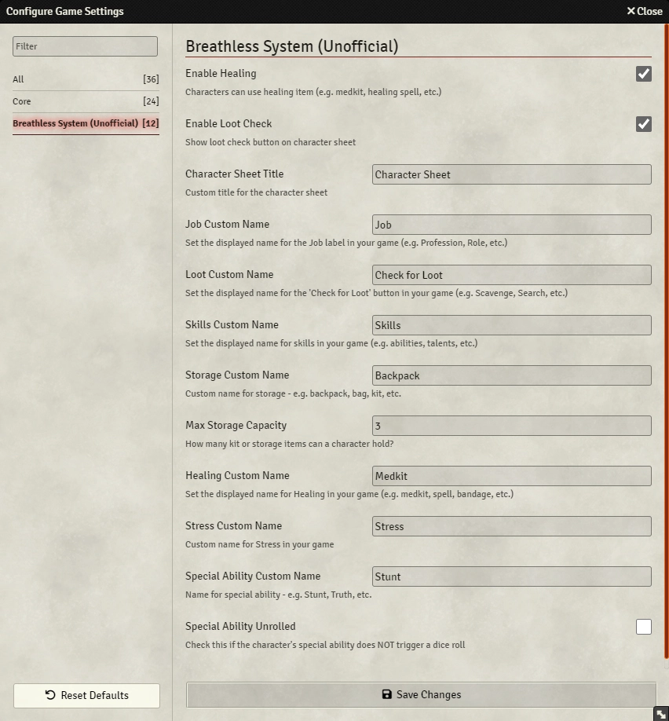

# Breathless v2 (Unofficial) System

An unofficial system for playing the Breathless TTRPGs (Created by René-Pier Deshaies-Gélinas of [Fari RPGs](https://fari.community/creators/fari-rpgs)) on the Foundry VTT platform.

V2 made by me after: https://github.com/waryjack/breathless/

- The Breathless SRD: https://fari.community/creators/fari-rpgs/projects/breathless
- The Breathless Game: https://fari-rpgs.itch.io/breathless
- The Breathless Games Collection: https://itch.io/c/2381440/breathless-games

<!--- Downloads @ Latest Badge -->

Version 2 may vary a lot from this descripion

### Settings

Version 2 may vary a lot from this descripion

## Features

- Simple Character Sheet
  - Name, Pronouns, Occupation, Harm tracker
  - Safe Rest button (heals 0-3 Harms when clicked)
  - Notes tab
- Ability add and use Stats, dice type will change with use
- Use Loot, dice type will change with use
- Use Grit, rolls d12, will be hidden with use
- Ability add and use Gear, dice type will change with use
- System settings to help modify the sheet to match different versions of Breathless v2 games
- Simple NPC Sheet
- Dark & light modes versions of the character sheet, use settings to change
- Base Stats items (6) allready created in system compendium

## To Be Done

- Create a sample Loot table
- Add a few Gasps as settings

## How to Install

You can install the latest released version of the Breathless (v1) system by using this manifest link in Foundry VTT.

[Instructions](https://foundryvtt.com/article/tutorial/)
Link: https://github.com/waryjack/breathless/releases/latest/download/system.json

This MMFO's latest released Breatless version 2 (compatible v13 & v14) is downloadable from this manifest link in Foundry VTT.

Link: https://github.com/Mystery-Man-From-Ouperspace/breathless2/releases/download/breathless2/system.json

It will be soon downloadable directly from whithin Foundry VTT, for I sbmitted it to them. 

## Content License Note

This work is based on ["Breathless"](https://fari.community/creators/fari-rpgs/projects/breathless), product of [Fari RPGs](https://farirpgs.com/), developed and authored by René-Pier Deshaies-Gélinas, and licensed for our use under the [Creative Commons Attribution 4.0 License](https://creativecommons.org/licenses/by/4.0/)